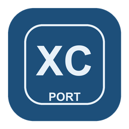

<p align="center"></p>

# Xenoblade Chronicles: Definitive Edition port for Retroid Pocket 5 & Flip 2

**Made for the Adreno 650.** A native Android port of the console version of **Xenoblade Chronicles: Definitive Edition**, built exclusively for the
**Retroid Pocket 5** and the **Retroid Pocket Flip 2** (Snapdragon 865), from **your own copy** of the game. The game's
own ARM64 code runs directly on the device's CPU, while this project reimplements the parts of the console it talks to.

> **Unofficial, non-commercial fan project.** Not affiliated with, endorsed or sponsored by the console maker or
> Monolith Soft. All trademarks belong to their owners. This repository contains **no game code and no game assets**. To use
> it you need a copy of the game that you bought, with its files extracted on your own console.

## Status

**Version 0.9 — playable.** Colony 9, the main menus and battles run at ~30 fps on the Flip 2 (battles are at the
GPU limit: occasional dips to ~29). Upscaled to 1080p with AMD FSR 1.

- Known issues: in some battles a thin green or teal line can flicker across the screen; shadows are as soft as in the
  console's handheld mode (an optional `sombras_2x` file doubles their resolution, at a GPU cost).

## Why only the Retroid Pocket 5 and Flip 2

This port was written for one chip, the **Snapdragon 865 with its Adreno 650 GPU**, and tuned to its limits instead of
trying to run everywhere:

- **Run the game, not a whole console.** Translating the full console system costs CPU, GPU and memory this chip does not
  have to spare. Here the game's own ARM64 code runs natively and only what it actually calls (files, threads, input,
  audio, graphics) is reimplemented, so almost the whole device is left for the game.
- **Built around the Adreno 650 and its stock Qualcomm Vulkan driver** (Vulkan 1.1). The graphics layer uses exactly the
  features this driver offers and works around its quirks; for example, GPU shader code that relies on features the
  Adreno 650 only has in compute shaders is rewritten so it renders correctly.
- **A 33 ms budget per frame.** The GPU usually runs at ~587 MHz, so the target is a **locked 30 fps**: the game renders
  at its handheld resolution (around 720p) and AMD FSR 1 upscales it to the 1080p screen. Where a game can get heavier
  than that budget, the internal resolution drops for a moment instead of the frame rate.
- **About 2.7 GB of free memory** out of 8 GB while a game runs. GPU caches have fixed limits so a big area never
  pushes the game out of memory, and translated shaders are stored on the device so each one is only built once.
- **Eight cores, used deliberately.** The game's threads run on the four big Cortex-A77 cores; background work (shader
  building, pipeline compiling) goes to the small Cortex-A55 cores so it does not steal time from the game.
- **Optional frame generation** to show ~60 fps, only when the GPU has room left after the real 30.

Developed and tested on the **Retroid Pocket Flip 2** (Android 13). The **Retroid Pocket 5** has the same chip, memory and
driver, so it should behave the same. Other Snapdragon 865 / Adreno 650 devices might work but are untested; devices
with other GPUs (other Adreno generations, Mali, PowerVR…) are not supported.

## What you need

- **The game files of version 1.1.2**, already extracted on your own console, as plain folders:
  - **ExeFS** — the folder with `main`, `main.npdm`, `sdk`, … of the game *with update 1.1.2 applied*
    (the app checks the build ID of `main`: `92c78bb3dcbbc3f7a3caf601d7b85f7a36c20907`).
  - **RomFS** — the game's RomFS with the same update applied.

- Enough free space for the game plus about 1 GB for the shader cache and saves (internal storage or SD card).

Why folders only? The app is deliberately limited to reading game files that are already extracted as plain folders; it
cannot open packaged or protected files, and it will tell you if the folder is not usable. This project does not explain
how to obtain the files and will not help with it. Please do not open issues asking for game files or how to get them.

## Install and first run

1. Download `xenobladeport-vX.Y.Z.apk` from the [latest release](https://github.com/IamWilmar/xenoblade-recomp/releases/latest) (or build
   it yourself, below) and install it on the device.
2. Copy your extracted game folders to the device, anywhere you like (for example one folder `Xenoblade` with the ExeFS
   and RomFS folders inside).
3. Open the app, grant *All files access*, browse to that folder with the touch screen or the d-pad and choose
   **Use this folder**. The app checks that the files are this game, the right version and not encrypted.
4. Press **Start game**. Next time the app goes straight to this screen.

Saves, the shader cache and `log.txt` are written into that same folder. The first time you visit each place the game
may stutter while its shaders are translated and compiled; they are cached for the next time.

## Options

Creating an empty file (or folder) with one of these names in the game folder changes how the port runs. They are read
at start-up.

| Name | Effect |
|---|---|
| `lsfg/` | Frame generation (Lossless Scaling's LSFG) to show ~60 fps. Needs **your own** `Lossless.dll` from the Windows app *Lossless Scaling* (sold on Steam), copied into that `lsfg` folder or to `Download/Lossless.dll`. Not included here. |
| `sombras_2x` | 1024×1024 shadow cascades instead of the handheld 512×512 (sharper, slower). |
| `registro` | Verbose log (line by line) plus a watchdog that prints the game's stack if it hangs. Slower: for debugging. |

## How it works

```
APK
├── SetupActivity (Java)   finds and checks the user's game files, then starts the native activity
└── NativeActivity
    ├── loader             maps main + subsdk* from the ExeFS, applies relocations, links imports,
    │                      patches the few instructions that cannot run on Android (svc, tpidrro_el0, counters)
    └── libnnsdk.so        reimplementation of the console SDK the game imports: nn::os (threads, sync, memory),
        │                  nn::fs (RomFS, saves), nn::hid (controller), audio (AAudio), codecs, …
        └── nvn/           the NVN graphics API on top of Vulkan; the game's Maxwell shaders are translated to
                           SPIR-V with Eden's shader recompiler, then cached
```

The SDK and NVN layers were written from scratch by observing what the game calls and with which values (there are no
official SDK headers or code in this repository); comments next to each deduced value give the evidence. Code comments
are mostly in Spanish.

## Building

Requirements (macOS or Linux): Android SDK with **NDK 28.2.13676358**, build-tools 35.0.0 and platform android-33; a JDK
(17 or newer); CMake ≥ 3.22; Python 3; git, curl and zip.

```bash
tools/setup.sh       # once: fetches the pinned third-party sources (Eden's shader recompiler, sirit, fmt, Boost…)
tools/build_apk.sh   # builds build/xenobladeport.apk
adb install -r build/xenobladeport.apk
```

`ANDROID_HOME` selects the SDK (default `~/Library/Android/sdk`). The APK is signed with the Android debug key unless you
pass `KEYSTORE=… KS_PASS=…`. For development, `tools/apk.sh` builds, installs, starts the game on the device connected by
adb and prints its log. The Python scripts in `tools/` are analysis helpers that work on your own extracted files in
`work/` (ignored by git).

## License

GPL-3.0-or-later (see [LICENSE](LICENSE)), because it builds on Eden's shader recompiler (GPL-3.0-or-later). Third-party
components and their licenses are listed in [THIRD_PARTY_NOTICES.md](THIRD_PARTY_NOTICES.md).

---

## En español

Port nativo para Android de la versión de consola de **Xenoblade Chronicles: Definitive Edition**. El código ARM64 del juego corre directo en la
CPU y este proyecto reimplementa el SDK de la consola y la API gráfica NVN sobre Vulkan.

- **Necesitas tu propia copia del juego**, versión 1.1.2, con el ExeFS y la RomFS ya extraídos en tu consola, como
  carpetas normales: la app solo lee archivos ya extraídos. Este repositorio no tiene código ni archivos del juego.
- Descarga la APK de [Releases](https://github.com/IamWilmar/xenoblade-recomp/releases/latest) e instálala. Copia esas carpetas al
  dispositivo, abre la app, dale el permiso de archivos, elige la carpeta y pulsa *Iniciar juego*.
  Las partidas y la caché de shaders se guardan en esa misma carpeta.
- Hecho exclusivamente para la Retroid Pocket 5 y la Retroid Pocket Flip 2 (Snapdragon 865, Adreno 650): todo está
  ajustado a ese chip y a sus límites (30 fps fijos con presupuesto de 33 ms por frame, ~2,7 GB de memoria libre, núcleos
  grandes para el juego). Probado en la Flip 2.
- Proyecto de fans, sin ánimo de lucro, sin relación con el fabricante de la consola ni
  con Monolith Soft.
